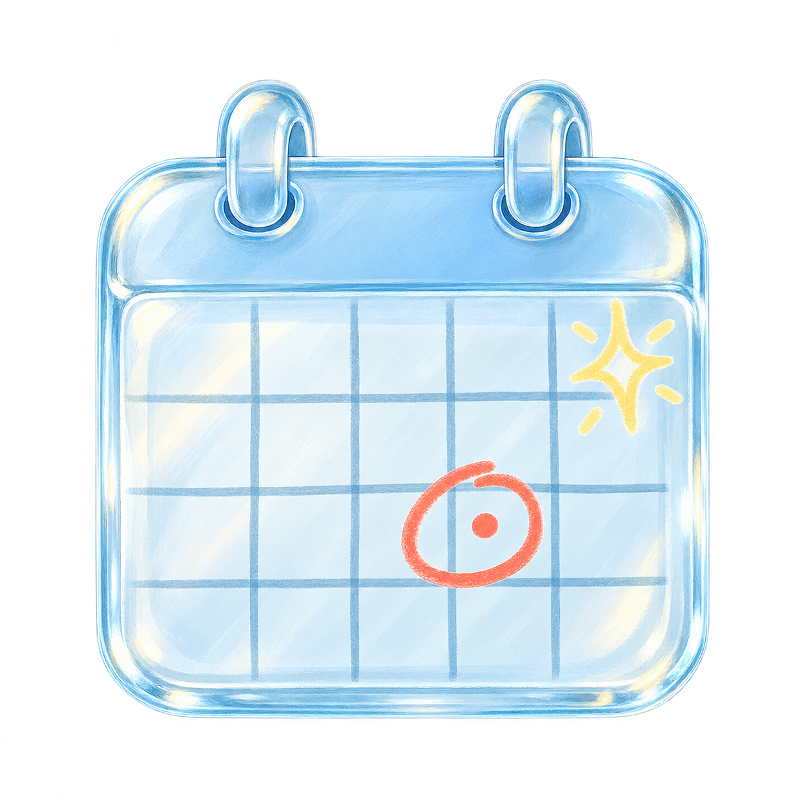
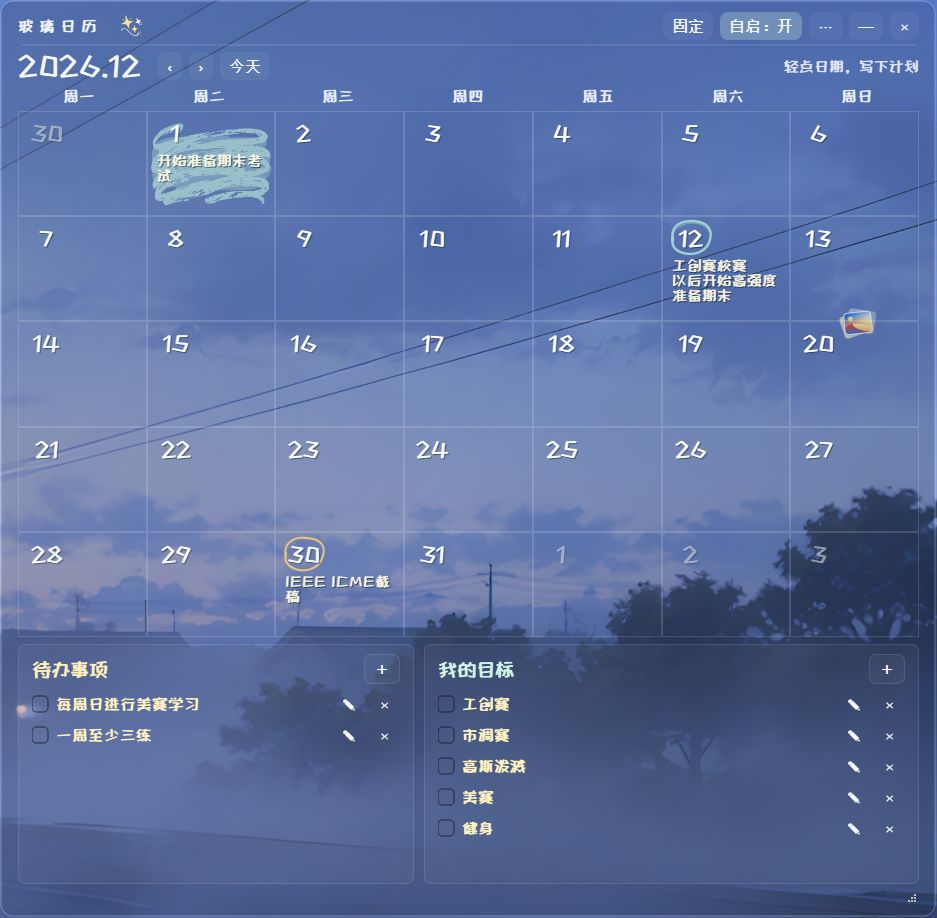

<div align="center">
  
  <h1>玻璃日历 · Glass Calendar</h1>
  <p><strong>把计划写在一块透出壁纸的玻璃上。</strong></p>
  <p>Windows 桌面日历 · 本地存储 · 手写涂鸦</p>
</div>

玻璃日历是一款 Windows 本地桌面日历，用来记录每天的日程、待办和目标。透明玻璃、手绘日期标记和实时桌面画面让计划融入你的壁纸；无需注册账号，数据保存在本机。



*桌面使用示例；界面外观会随版本更新。*

## 你可以用它做什么

- **写下每天的计划**：点击日期添加或修改内容，翻看月份，也可以一键回到今天。
- **用手绘标记重点**：为日期画圈、涂色并选择颜色；保存时随机选择笔触，重开后保持原样。
- **管理待办和目标**：添加、编辑、勾选完成或删除事项，可设置截止时间及托盘提醒。
- **放在桌面上**：玻璃面板透出壁纸；可移动、调整大小、固定位置，并通过菜单设置桌面置底。
- **安静地常驻**：不占用任务栏；关闭窗口后进入托盘，双击托盘图标恢复，支持开机自启。

> 截止时间提醒需要程序运行且 Windows 通知可用。程序关闭或电脑休眠期间不会弹出通知；重新运行或唤醒后，未完成且尚未提醒的过期事项会补报。月历中的文字暂不提供提醒，请为待办或目标设置截止时间。

## 开始使用

需要 **Windows 10/11** 和 **Python 3.10 或更高版本**。下载源码，在项目目录打开 PowerShell：

```powershell
py -m venv .venv
.\.venv\Scripts\python -m pip install -r requirements.txt
.\.venv\Scripts\pythonw main.py
```

安装依赖后，也可以双击项目中的 `启动玻璃日历.bat` 启动。

1. **添加日程**：点击日期，写下内容；需要时选择“圈起日期”“给当天涂色”和颜色，再保存。
2. **添加待办或目标**：点击对应面板的 `＋`；笔形按钮用于编辑，`×` 用于删除。
3. **调整桌面位置**：解锁后拖动顶部空白处或右下角；点击“固定”锁定位置和大小。
4. **设置自启或置底**：点击顶部“自启”按钮，或在 `⋯` / 系统托盘菜单中设置；菜单也提供退出入口。

## 玻璃效果与数据

玻璃面板使用 Windows 桌面窗口管理器实时采样桌面画面，并在整块圆角玻璃内做轻微放大，画面会随日历移动更新。桌面源不可用或窗口超出桌面源时，相应区域回退为普通透明背景。效果和可读性取决于壁纸与 Windows 桌面合成环境，桌面图标也可能出现在采样画面中。

日程、待办、目标和窗口设置保存在 `%USERPROFILE%\GlassCalendar\data.json`，同目录的 `data.bak` 保留上一版。写入先刷新至磁盘再替换；主文件缺失或损坏时会尝试从备份恢复。首次运行会从旧版 `%APPDATA%\GlassCalendar` 复制已有数据。**备份时请同时复制这两个文件**；突然断电、磁盘故障或文件被外部删除仍可能造成数据损失。

开机启动使用当前用户的 Windows `Run` 注册表项，并在启动文件夹中设置登录 45 秒后的补充启动；已有实例运行时不会重复打开。移动程序文件夹后，请关闭并重新开启自启，以更新路径。

## 打包与测试

在项目目录执行：

```powershell
py -m venv .venv
.\.venv\Scripts\python -m pip install -r requirements-build.txt
.\.venv\Scripts\python -m unittest discover -s tests -v
powershell -NoProfile -ExecutionPolicy Bypass -File .\build.ps1
```

构建结果位于 `dist/GlassCalendar/`。请整体分发该文件夹，并运行其中的 `GlassCalendar.exe`。构建前请关闭正在使用该输出目录的日历实例；构建脚本会临时限制 PATH，防止混入其他软件的同名 DLL。程序未进行数字签名，首次运行时 Windows 可能显示提示；项目不包含自动更新。

桌面置底使用普通窗口置底，并非嵌入桌面图标层。项目目前只针对 Windows 测试，不支持同步、重复事项或关闭应用后的系统级定时提醒。

## 许可证与素材

- 项目源码采用 [MIT 许可证](LICENSE)。PySide6 和 Qt 等第三方组件使用各自的许可证；分发打包程序时请遵守相应许可并提供声明。
- 内置字体 [ZCOOL KuaiLe](https://github.com/googlefonts/zcool-kuaile) 采用 SIL Open Font License 1.1，详见[字体许可](assets/ZCOOLKuaiLe-OFL.txt)。
- `assets/doodle-sparkles.png` 使用 OpenAI 内置图像生成工具生成，提示词为“transparent hand-drawn white and pale-yellow marker sparkles on glass, no text”。
- `assets/glass-calendar-icon.png` 使用 OpenAI 内置图像生成工具生成，提示词为“translucent blue glass calendar icon, coral marker circle and small yellow sparkle, transparent background, no text”；ICO 文件由原图转换，用作 Windows 图标。
- `assets/marker-dry-1.png` 和 `assets/marker-dry-2.png` 使用 OpenAI 内置图像生成工具生成，提示词聚焦“transparent dry marker scribble, broken ink, rough edges”。日期标记会在运行时着色并保留透明度。
